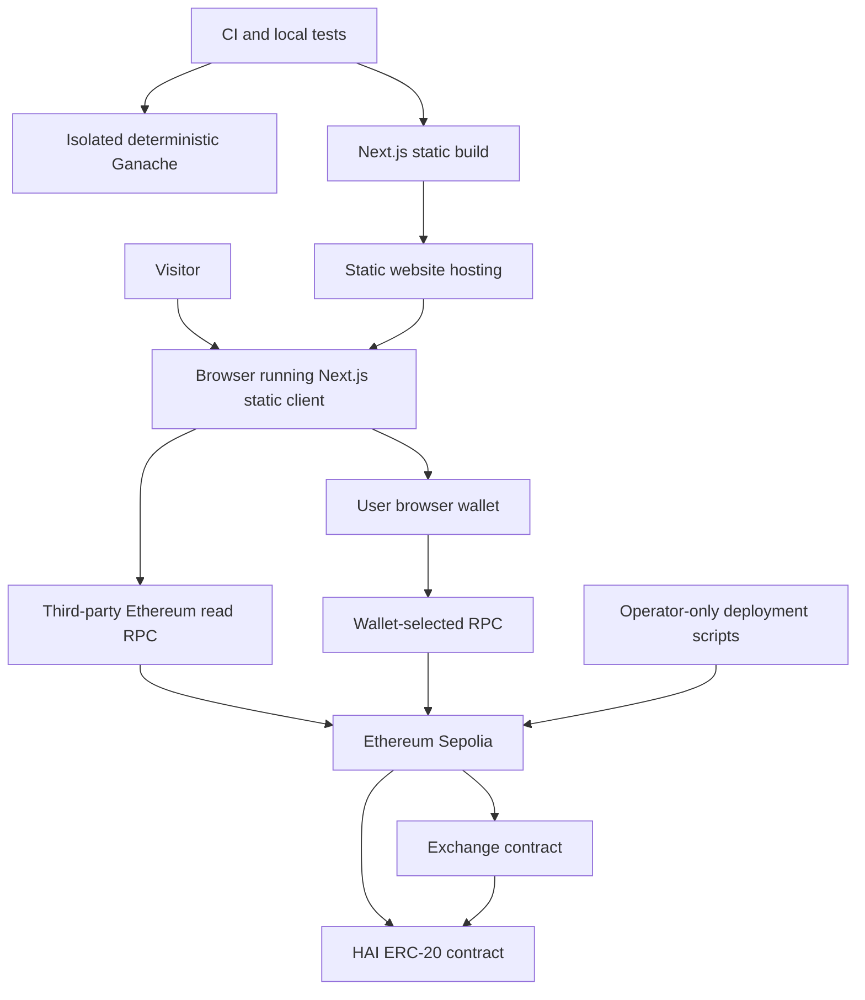
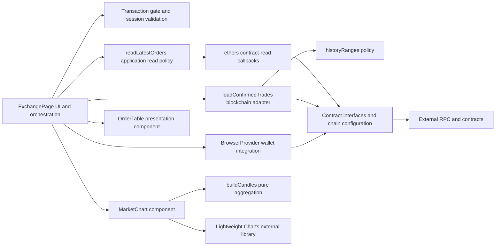
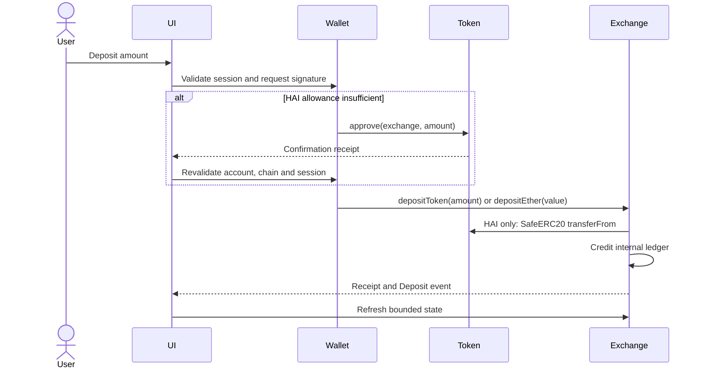
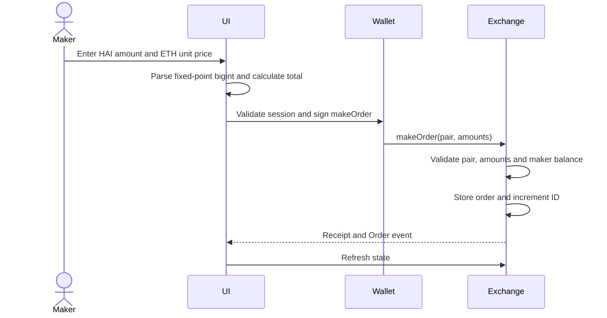
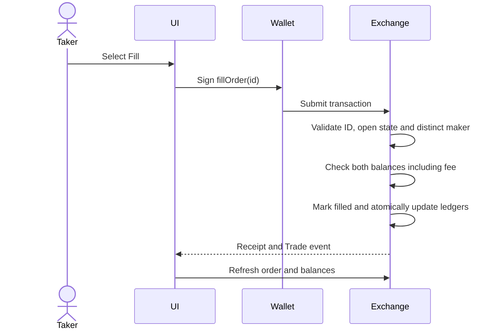
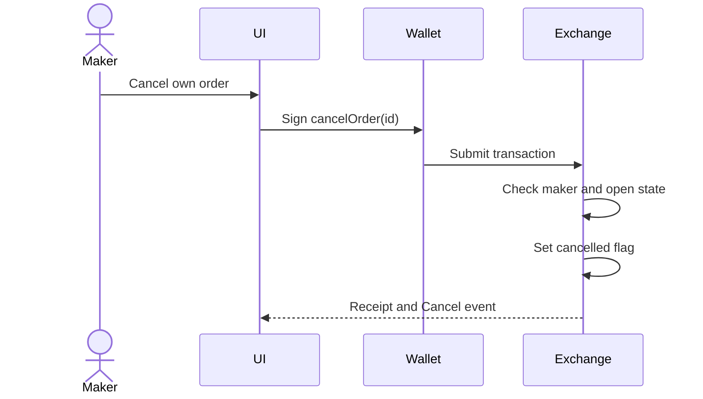
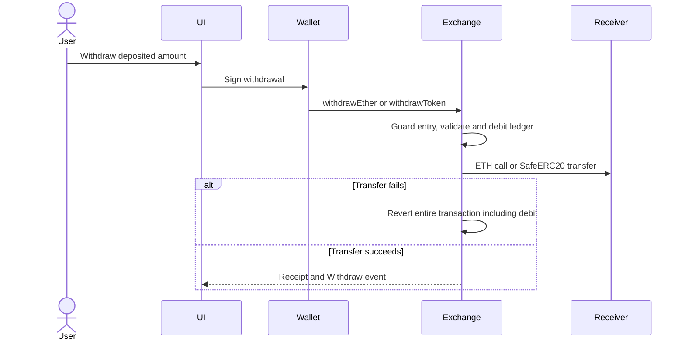
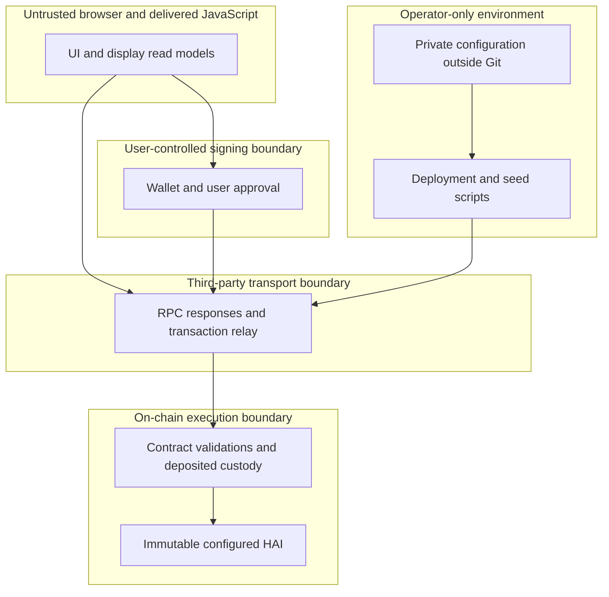
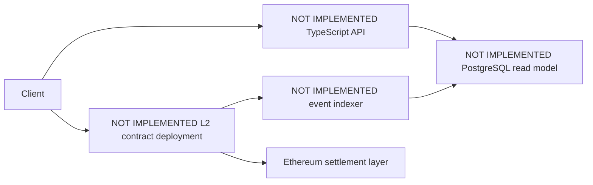

# Architecture: current implementation and trust boundaries

Canonical diagrams for the current application. Source inventory: [ENGINEERING_AUDIT.md](ENGINEERING_AUDIT.md). The active backend is the deployed exchange contract. There is no off-chain application server/database today.

## A. System context — implemented

The Build→Hosting edge is a separate publication operation, not an automatic CI deploy. Test contracts and synthetic Ganache accounts are unrelated to deployed addresses. No public-chain write is required to test or benchmark.

## B. Component architecture — implemented

`app/page.tsx` still contains application services (`connect`, `transact`, `funds`, `createOrder`) as functions; there is no separate service process or dependency-injection framework. `lib/read-model.mjs` separates bounded scheduling from ethers callbacks; `lib/trades.ts` remains the chain adapter. Experimental event replay is not a live-source component.

## C. Transaction sequences

### Deposit

Token custody must increase by the exact credited amount. ETH uses native transaction value. UI success is based on the receipt; the contract performs authorization/accounting.

### Place limit order

Creation checks available funds but does not reserve them. No automatic matching occurs.

### Fill order

No ERC-20 external transfer occurs during settlement; it moves deposited internal balances. Two competing fills are ordered by the chain; only the first valid fill can succeed.

### Cancel order

Cancellation is not guaranteed to beat a pending fill. The mined order of transactions determines the outcome.

### Withdraw funds

## D. Trust boundaries

Browser/RPC data is not an authorization boundary. A malicious frontend can request harmful signatures; a wallet signature is not proof of informed consent. The immutable token's behavior is a contract assumption; this is not an arbitrary-token exchange. Operator keys do not belong in the browser, tests, benchmark fixtures or CI.

## State ownership and failure recovery

| State | Owner | Recovery / failure behavior |
| --- | --- | --- |
| Deposits/orders/fees | Contract storage | Reverts atomically on validation failure; actual chain state wins over UI |
| Wallet account/chain | User wallet | Account/chain events invalidate session; reconnect; recheck after approval |
| Order list and fill cache | Browser memory | Rebuilt by polling; session/request guards suppress old results; not reorg-safe |
| Transaction gate | Browser synchronous helper | Released in `finally`; prevents concurrent UI submissions, not external transactions |
| Receipt/hash messages | Browser UI | Rejection/errors shown; no persistent transaction journal or automatic broadcast retry |
| Deployment/seed steps | Local public checkpoint files | Submitted hashes recorded, receipts awaited; rerun reuses completed steps |
| Historical chart | Derived browser state | Range errors set chart error without discarding the book; missing/old trades remain absent |

Lifecycle: validate → request signature → submit → await receipt → refresh. Inclusion is not a guarantee against later reorg. A wallet rejection differs from a revert, RPC outage, replacement or timeout. Errors currently surface through a shared formatter; a persistent pending/replaced-transaction recovery service is **not implemented**. A confirmed transaction followed by failed refresh can produce ambiguous UI feedback and remains a known issue.

The seed script retries only rejected gas estimates (up to five attempts, 2-second delay) before submission; nonce managers reset between retries. It does not blindly retry uncertain broadcasts. Checkpoint writes occur after submission, so a process crash between broadcast and saving can still require manual transaction-history reconciliation. Failed saved transactions/leftover locks also require operator inspection. No automatic UI transaction retries are introduced.

## Future architecture — all components below NOT IMPLEMENTED

A proposed indexer would backfill from a saved block, persist canonical block hashes and log identities, roll back orphaned data, and replay idempotently. PostgreSQL would be a rebuildable read model, not the asset custodian. A TypeScript API would provide bounded pagination, account history and candles. Wallet-signed contract writes would remain authoritative. Base Sepolia is a possible validation target, not an enabled chain or existing deployment. Mainnet remains gated on independent review and operational/security acceptance criteria.
